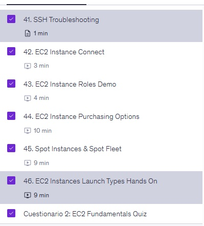
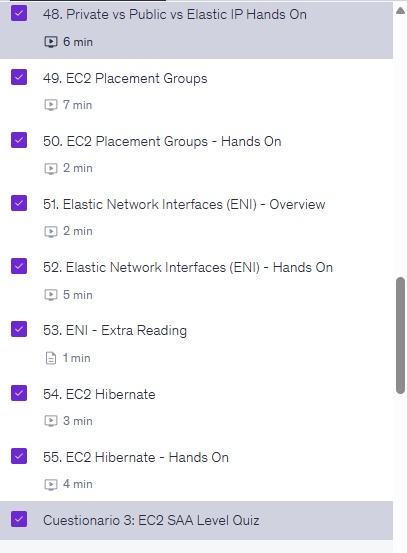

# Module 1 / Lab 0.5: Basics Continued

Week 2 homework. Repo setup in the required format, Maarek quizzes for Sections 5 and 6, and the assigned reading and videos.

## Maarek quizzes

| Section | Topic | Screenshot |
|---|---|---|
| 5 | EC2 Fundamentals (Quiz 2) | [Maarek_Section5_quiz.jpg](screenshots/Maarek_Section5_quiz.jpg) |
| 6 | EC2 Solutions Architect Associate Level (Quiz 3) | [Maarek_Section6_quiz.jpg](screenshots/Maarek_Section6_quiz.jpg) |

### Section 5: EC2 Fundamentals

Covers SSH troubleshooting, EC2 Instance Connect, instance roles, purchasing options, Spot Instances and Spot Fleet, and launch types.

### Section 6: EC2 Solutions Architect Associate Level

Covers private vs public vs Elastic IPs, placement groups, Elastic Network Interfaces (ENI) and EC2 Hibernate.

