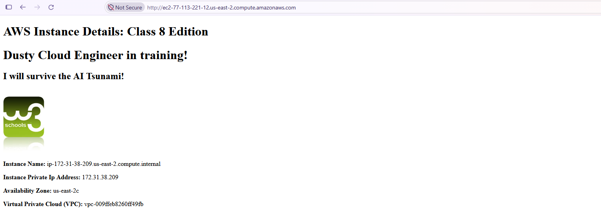
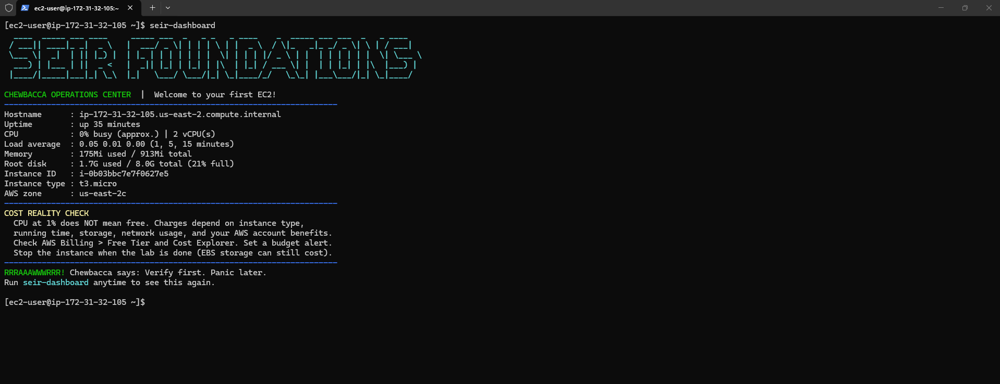
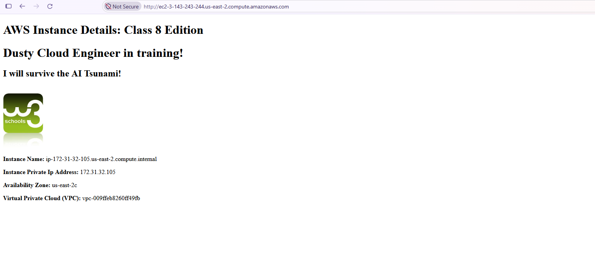
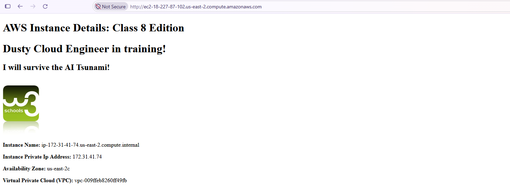

# Module 1 / Lab 0: EC2 Basics

Launch, connect, observe, repeat. I created an EC2 launch template (Amazon Linux 2023 + the SEIR User Data script) and launched three separate instances from it, connecting to each one over SSH. Each deployment received a different public IPv4 address.

**Region:** us-east-2 (Ohio)
**Instance type:** t3.micro
**VPC:** vpc-009ffeb8260ff49fb
**Connection method:** SSH client with a `.pem` key pair, user `ec2-user`

## Evidence table

| Deployment | Public IPv4 address | Private IPv4 address | Connection method | Screenshot | Instance terminated? |
|---|---|---|---|---|---|
| 1 | `77.113.221.12` | `172.31.38.209` | SSH | [web page](screenshots/deployment-1-web.png) | Yes |
| 2 | `3.143.243.244` | `172.31.32.105` | SSH | [web page](screenshots/deployment-2-web.png), [SSH dashboard](screenshots/deployment-2-ssh-dashboard.png) | Yes |
| 3 | `18.227.87.102` | `172.31.41.74` | SSH | [web page](screenshots/deployment-3-web.png) | Yes |

Three distinct public IPv4 addresses, all in availability zone us-east-2c.

## Deployment 1

Launched an instance from the launch template and waited for it to pass its status checks. Opening the instance's public DNS name (`ec2-77-113-221-12.us-east-2.compute.amazonaws.com`) in the browser showed the page generated by the User Data script, confirming that Apache was installed and the script ran at launch. The page reports the instance's hostname, private IP, availability zone and VPC.

## Deployment 2

Launched a second instance from the same launch template, which received public IPv4 `3.143.243.244`. I connected over SSH as `ec2-user` and ran `seir-dashboard` to display the SEIR system dashboard. The hostname shown in the terminal (`ip-172-31-32-105`) matches the instance name on the web page, so both screenshots belong to the same instance.

| Field | Value |
|---|---|
| Instance ID | `i-0b03bbc7e7f0627e5` |
| Instance type | t3.micro |
| Availability zone | us-east-2c |
| Private hostname | ip-172-31-32-105.us-east-2.compute.internal |
| Public IPv4 | 3.143.243.244 |

## Deployment 3

Launched a third instance from the launch template, which received public IPv4 `18.227.87.102`, different from the two previous deployments. The web page loaded from the public DNS name and showed a new private IP (`172.31.41.74`) in the same VPC and availability zone.

## What the dashboard tells me

Readings from Deployment 2:

- **CPU** 0% busy on 2 vCPUs, load average 0.05 / 0.01 / 0.00. The server is idle and nothing heavy is running.
- **Memory** 175 MiB used of 913 MiB. Plenty of headroom for a t3.micro running only the base OS and Apache.
- **Root disk** 1.7 GB used of 8 GB (21%). The default 8 GB volume is enough for this lab.
- **Uptime** 35 minutes. The instance keeps running, and billing, until it is stopped or terminated.

## What got easier with repetition

Knowing what to change and what to leave alone. On the first launch every setting looked important. By repeating the launch, it became clear which parts actually needed my input (instance type, key pair, inbound SSH rule) and which should stay at their defaults, such as the security group's outbound rules.

## Cleanup

- [x] Launch template kept for Lab 1 (`MyFirstTemplate`)
- [x] All practice instances terminated
- [x] Checked EC2 for leftover volumes and public IPs
