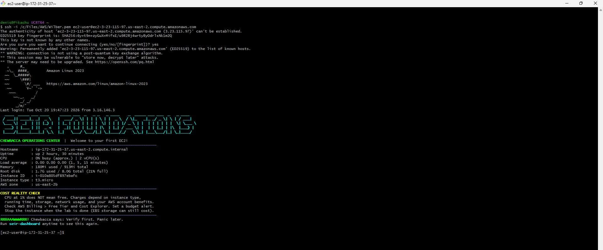
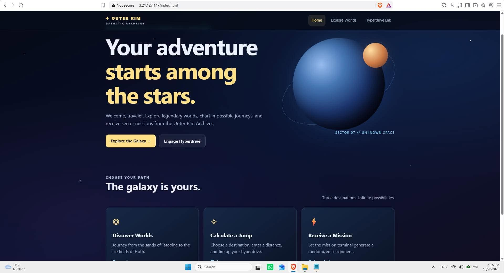
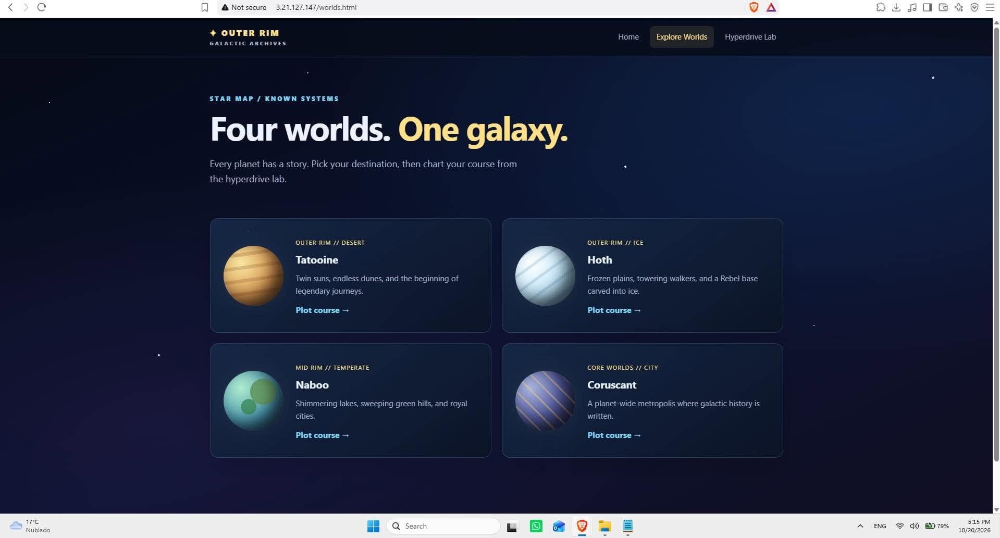
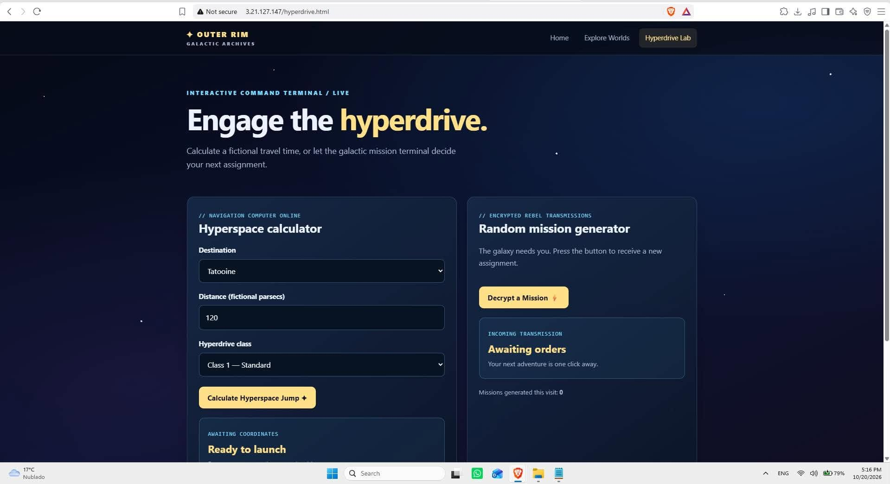

# Module 1 / Lab 0: EC2 Basics

Launch, connect, observe, repeat. Three separate EC2 deployments from a saved launch template (Amazon Linux 2023 + the SEIR User Data script), each reached over SSH, each with a distinct public IPv4 address.

**Region:** us-east-2 (Ohio)
**Instance type:** t3.micro
**Connection method:** SSH client (Git Bash / MSYS2 on Windows) with a `.pem` key pair, user `ec2-user`

## Evidence table

| Deployment | Public IPv4 address | Connection method | Screenshot | Instance terminated? |
|---|---|---|---|---|
| 1 | `3.23.115.97` | SSH | [deployment-1-ssh-dashboard.png](screenshots/deployment-1-ssh-dashboard.png) | Yes |
| 2 | `3.21.127.147` | TODO | [web index](screenshots/deployment-2-web-index.png), [worlds](screenshots/deployment-2-web-worlds.png), [hyperdrive](screenshots/deployment-2-web-hyperdrive.png) | Yes |
| 3 | `TODO` | SSH | `screenshots/deployment-3.png` | TODO |

## Deployment 1

Launched an Amazon Linux 2023 instance from the saved launch template and connected from my local terminal with:

```bash
ssh -i /c/Files/AWS/Wilber.pem ec2-user@ec2-3-23-115-97.us-east-2.compute.amazonaws.com
```

On first connection SSH asked me to confirm the host's ED25519 fingerprint, which is expected for a new server. After accepting, the SEIR dashboard loaded automatically, confirming that the User Data script ran at launch.



| Field | Value |
|---|---|
| Instance ID | `i-010a805df897ebafc` |
| Instance type | t3.micro |
| Availability zone | us-east-2b |
| Private hostname | ip-172-31-25-37.us-east-2.compute.internal |
| Public IPv4 | 3.23.115.97 |

## Deployment 2

Public IPv4 `3.21.127.147`. The instance served the web pages below over HTTP on port 80 (`index.html`, `worlds.html`, `hyperdrive.html`).

Launched from the same saved launch template as Deployment 1. Besides the SEIR dashboard, I used this instance to host a small custom static site ("Outer Rim Galactic Archives") that I built with the help of an AI assistant, served by Apache on port 80. The screenshots show the three pages loading from the instance's public IPv4.

TODO: add the SSH dashboard screenshot for this instance.





## Deployment 3

TODO

## What the dashboard tells me

Readings from Deployment 1:

- **CPU** 0% busy on 2 vCPUs, load average 0.00. The server is idle; nothing heavy is running.
- **Memory** 180 MiB used of 913 MiB. Plenty of headroom for a t3.micro running only the base OS and Apache.
- **Root disk** 1.7 GB used of 8 GB (21%). The default 8 GB gp3 volume is enough for this lab.
- **Uptime** 2 hours 30 minutes. Uptime is a good reminder that the instance keeps running (and billing) until it is stopped or terminated.

## What got easier with repetition

Knowing what to change and what to leave alone. On the first launch every setting looked important. By repeating the process from the launch template, it became clear which parts actually needed my input (instance type, key pair, inbound SSH rule) and which should stay at their defaults, such as the security group's outbound rules.

## Errors and how I fixed them

TODO

## Cleanup

- [x] Launch template kept for Lab 1 (`MyFirstTemplate`)
- [x] All practice instances terminated
- [x] Checked EC2 for leftover volumes and public IPs (none found in us-east-2)
